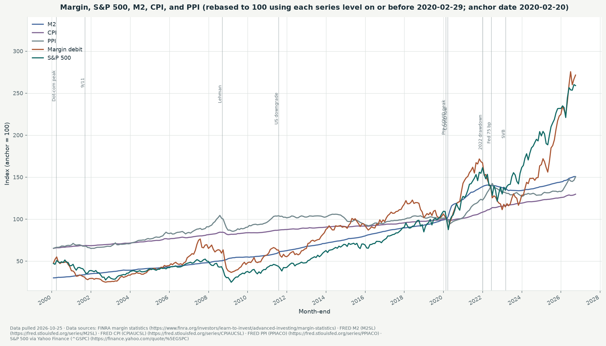

# margin-sp500-m2-visualization

Download FINRA margin debit balances, FRED M2 / CPI / PPI, and S&P 500 levels,
align them on a monthly grid from 2000 onward, rebase every series to 100 using a
configurable anchor date, and plot the result with vertical markers for major
market events.



## Chart components

The page follows the Ontario mortgage chart's compact native SVG layout: a
legend above the plot, one shared time axis, an on-plot tooltip, and collapsed definitions/sources. It has no plotting runtime, CDN,
zoom toolbar, range slider or log-scale controls. The generated HTML is fully
self-contained, including its data, styles and JavaScript.

Shared plot components live in `../src/staticsites/charts.py` and
`../src/staticsites/assets/plots/`; their CSS/JS is embedded at build time. PNG exports continue to use Matplotlib with the same
palette and neutral colors. The chart anchor remains configurable at build time
with `--rebase-date`; there is no browser click-to-rebase control.

## Visual snapshots

The Matplotlib PNG in `output/` remains a separate static chart.

[Desktop (1440 × 900)](tests/snapshots/desktop.jpg) ·
[Mobile (390 × 844)](tests/snapshots/mobile.jpg)

Generate review images of the actual HTML page:

```sh
make snapshot-browser  # explicit headless Chromium setup; repeat after Playwright upgrades
make snapshots         # rebuild from committed data, then capture both views
```

Capture uses a temporary loopback server and fresh light-mode contexts. Mobile
uses touch emulation. All plots, the inspection readout, fonts and responsive
geometry must finish rendering before capture; page errors, external requests
and horizontal overflow fail the command. Both captures must succeed before
existing review images are replaced. These JPEGs show the initial viewport;
longer pages continue below the image. They are visual review references, not
automated pixel comparisons.

The chart pages are self-contained, so capture works offline once the locked
Python dependencies and browser are installed. Browser downloads happen only
through `make snapshot-browser`. Ordinary builds, tests and data refreshes do
not install browsers or capture images. Recapture after visual changes and
commit the reviewed images. On Linux, install Chromium's
[manual system prerequisites](https://playwright.dev/python/docs/browsers#install-system-dependencies)
if needed; the targets do not install OS packages.

Optional browser fixtures check incomplete rendering, moving paths, page errors,
overflow and blocked external resources without live data or network assets:

```sh
make browser-test # shared offline browser fixtures; browser setup is explicit
```

## Usage

Render both charts from the committed `data/series.csv` (offline):

```sh
make
```

`make deps` installs the repository-root `.venv` from the single root lockfile. Targets follow the repo
standard — see the [repo README](../README.md):

- `make` — render `output/margin-sp500-m2-visualization.{html,png}` from `data/series.csv`
- `make data` — refetch FINRA / FRED / Yahoo into `data/series.csv`, then re-render
- `make test` — run the unit tests
- `make open` — open the interactive chart
- `make clean` — remove the generated output

The output format follows the file extension, so the script can also be driven
directly:

```sh
../.venv/bin/python src/plot_macro_series.py -o output/chart.html --rebase-date 2008-09-15
```

## Interactive chart

Open the committed HTML in a browser:

- Hover or tap any plot, or focus it and use Left/Right/Home/End, to inspect values
  from each series at that month. Missing or unpublished values are shown as
  “No observation”. Lines stop at their latest available month and break at gaps.
- Tap legend entries to hide/show lines. Each panel keeps at least one visible.
- The full available history is always shown. The page fits mobile screens
  without a separate chart toolbar or horizontal page scrolling.

Optional component-model checks use Node 18+ built-ins only:
`node tests/test_chart.cjs`. Standard `make test` remains Python-only; shared tests run via root `make check`.

## Data sources

- **FINRA** margin statistics (debit balances) — `margin-statistics.xlsx`
- **FRED** — M2, CPI, PPI series via `fredgraph.csv`
- **S&P 500** levels via `yfinance`

Each series keeps its own published coverage on the shared monthly grid.
Missing values stay empty, including months beyond a series’ latest observation.
S&P 500 uses completed month-end closes.

`src/fetch_data.py` (`make data`) pulls all three into `data/series.csv`, which
is committed so that `make` renders offline and reproducibly.

## Refresh and dependencies

This project includes the repository's [shared Python/uv Make template](../python-project.mk).
Its own Makefile defines artifact inputs, rendering rules, and any configuration
overrides. Build inside the repository checkout so the shared template is available.

`make system-deps` installs [uv](https://formulae.brew.sh/formula/uv)
on macOS using [Homebrew](https://brew.sh), which must already be installed.
On other platforms, install those tools manually before `make deps` / `make data`.
System installation runs only when explicitly requested; other targets never
invoke it. Credentials must be supplied separately.

`make deps` installs the repository's complete locked Python environment, including
test dependencies, when it is new or the dependency manifests change. `make data`
uses the same setup before fetching all required upstream inputs. Repeated commands
reuse the environment; they do not attempt repairs. To reinstall from scratch, run
`make clean-deps && make deps` (`clean-venv` remains an alias). Missing or stale
locks fail without being rewritten.
Dependency setup may require network access; installed builds/tests are offline.
`make data` obtains every required input and rebuilds outputs automatically.
Unchanged upstream content preserves data timestamps; missing generated files are
restored. Required-source failures retain previous datasets and return an error.

Shared build-time components and the single Python environment are documented
in the [repo README](../README.md). Project `make clean-deps` removes that shared
environment, not a private environment. Add dependencies at the repository root;
`site.toml` holds listing metadata and `pytest.ini` configures this project’s tests.
The generated HTML remains standalone and embeds its application assets/data.
